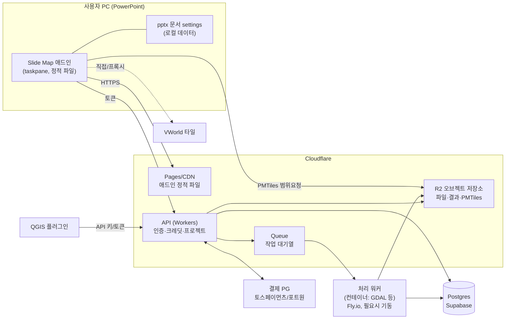
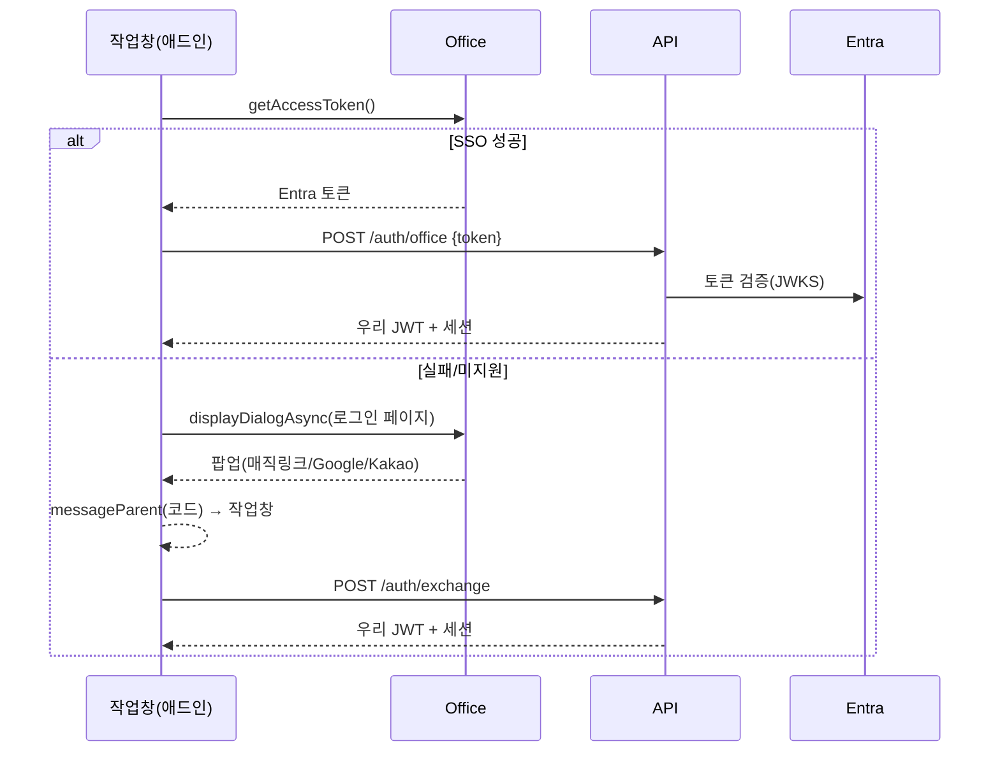
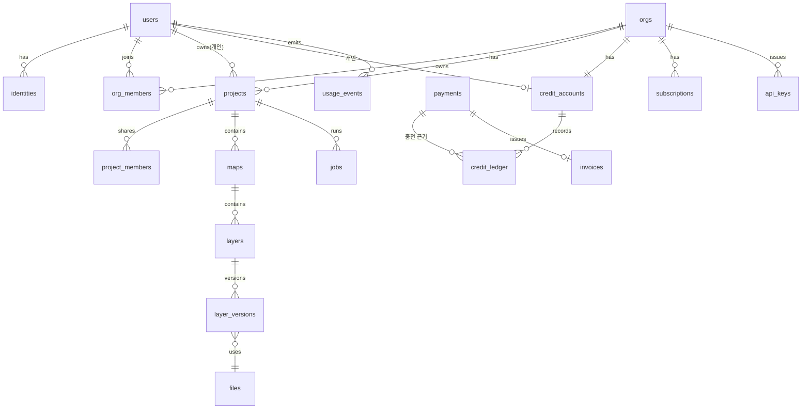

# Slide Map 서비스화 기획안 (로그인 · 크레딧 · 프로젝트 관리)

> 작성: 2026-11-17 · 상태: **기획/검토 문서 (구현 없음)**
> 전제: v2 단일 패널 애드인, 정적 호스팅, 지도 데이터는 pptx 문서 settings 에 저장 (`docs/ARCHITECTURE.md`, D-029)
> 표기: `[확인 필요]` = 직접 확인 전의 가정/기억. `(2026-11 조회)` = 이번 문서 작성 시 웹 검색으로 확인한 공개 가격.
> 환율 가정: 1 USD = 1,400원 `[확인 필요]`. 가격 표기는 부가세(VAT 10%) 포함가 기준.

---

## 0. 읽는 법

- 급하면 **1장(한 장 요약)** 과 **10장(결정할 질문)** 만 읽으면 된다.
- 백엔드 용어는 문서 맨 끝 **용어 사전(11장)** 에 모았다.
- 표의 숫자는 "대략 이 정도 규모"를 보기 위한 추정이다. 실제 계약/청구서가 아니다.

---

## 1. 한 장 요약 (결론 먼저)

### 1.1 결론 5줄

1. **"로컬은 영원히 무료, 클라우드만 유료"** 로 간다. 지금 도구(데이터가 pptx 안에 저장, 서버 없음)는 그대로 무료로 유지하고, 서버가 *필요한 일*(대용량 처리, 고해상도 렌더, 클라우드 프로젝트 보관, 팀 공유, QGIS 동기화)에만 로그인과 크레딧을 붙인다.
2. 서버는 **작게 시작**한다: Cloudflare(정적 호스팅·API·R2 저장소) + Postgres(Supabase) + 필요할 때만 뜨는 처리 워커(Fly.io 등). 초기 월 고정비는 **약 5~6만 원**.
3. 결제는 **토스페이먼츠(또는 포트원 경유)** 로 시작(카드·정기결제·세금계산서 대응). 해외 결제(Stripe)는 Phase 2 이후 선택.
4. 크레딧은 **원장(ledger) 방식** 으로 기록한다(잔액 칸 하나를 고치는 방식 금지). 환불·분쟁·중복결제에 안전하다.
5. 수익성: **인프라 비용은 사실상 문제가 아니다.** 진짜 비용은 **개발자·지원 인력의 시간**이다. 인건비 월 300만 원을 포함해도 **유료 사용자 약 300명** 이면 손익분기(아래 1.4).

### 1.2 추천 경로

```
Phase 0 (지금)       Phase 1 (4~6주)           Phase 2 (+6~8주)        Phase 3 (수요 확인 후)
무료 로컬 도구   ─▶  로그인 + 클라우드 프로젝트  ─▶  팀/결제 고도화       ─▶  공공/기업 온프레미스
정적 호스팅          + 크레딧 MVP                  세금계산서·팀 권한       폐쇄망 설치형
서버비 ≈ 0           서버비 ≈ 5~6만원/월           서버비 ≈ 15~20만원/월    별도 견적 (계약형)
```

### 1.3 MVP 범위 (Phase 1) — "이것만 만든다"

| 포함 (Must) | 제외 (나중에) |
|---|---|
| 이메일 매직링크 + Google 로그인 (+ Microsoft SSO 시도) | Kakao 로그인, 조직 SSO(SAML) |
| 클라우드 프로젝트 저장/불러오기 (지도 1개 = 프로젝트 1개 단위) | 팀 공유, 권한 세분화 |
| 대용량 GIS 파일 클라우드 변환 (SHP/GPKG/DXF → 경량 벡터) | 버전 히스토리 UI (DB 는 처음부터 준비) |
| 크레딧 구매(팩 3종) + 사용 + 잔액/내역 화면 | 구독, 세금계산서 자동발행 |
| 고해상도 배경지도 렌더 (크레딧 차감) | QGIS 클라우드 동기화 |
| 사용량 한도·레이트 리밋·예산 알림 | 공공 조달 대응 |

### 1.4 월 비용과 손익분기 (요약 — 근거는 7장)

가정: 유료 전환율 8%, 유료 1인당 월 결제 12,000원(VAT 포함), PG 수수료 약 3.5%.

| 규모 | 월 사용자(MAU) | 유료 사용자 | 월 매출(VAT 제외) | 월 인프라비 | 인프라비 비중 |
|---|---|---|---|---|---|
| 소 | 100 | 8 | 약 8.7만 원 | 약 5.5만 원 | 63% |
| 중 | 1,000 | 80 | 약 87만 원 | 약 17만 원 | 20% |
| 대 | 10,000 | 800 | 약 873만 원 | 약 60만 원 | 7% |

| 손익분기 기준 | 필요한 유료 사용자 | 필요 MAU (전환율 8% / 4%) |
|---|---|---|
| 인프라비만 (사이드 프로젝트) | **약 16명** | 약 200 / 400 |
| 인프라 + 인건비 월 300만 원 | **약 300명** | 약 3,800 / 7,500 |
| 인프라 + 인건비 월 600만 원 (2인) | **약 600명** | 약 7,500 / 15,000 |

> 해석: "서버가 돈을 못 번다"가 아니라 "**유료 고객을 몇 명 모을 수 있나**"가 사업의 관건이다. 도시계획/컨설팅 실무자는 전 세계적으로 좁은 시장이다(한국 한정 시 더 좁음). 현실적 목표는 **B2B(엔지니어링사 팀 라이선스) 비중을 키우는 것**.

---

## 2. 고객 · 가치 · 경쟁

### 2.1 누가 돈을 내나

| 고객 | 누구 | 무엇에 돈을 내나 | 결제 방식 | 의사결정 |
|---|---|---|---|---|
| **개인 실무자** | 도시계획·조경·건축·환경영향평가 보고서를 쓰는 주니어~시니어, 프리랜서 | 지도 슬라이드를 **몇 시간 → 몇 분** 으로 줄이는 시간 | 카드, 월 구독/크레딧 | 본인 즉시 결제 (소액) |
| **엔지니어링사/설계사무소 팀** | 5~100명 규모 용역 수행 회사 | 팀 공유, 프로젝트 보관, 표준 템플릿(방위표·범례), 세금계산서 | 연간 계약 / 세금계산서 | 팀장 → 총무/재무. 보안 검토 필요 |
| **공공기관** | 지자체, 공사, 연구원 | 설치형/폐쇄망, 지원, 납품 요건 | 조달/수의계약 | 길고 까다로움 (Phase 3) |

### 2.2 핵심 가치 (돈 내는 이유)

1. **"편집 가능한 객체"**: 지도가 통짜 그림이 아니라 배경 PNG + 레이어별 SVG + 네이티브 텍스트 라벨 + 방위표/축척/범례. PPT 안에서 색·선·글자를 바로 고칠 수 있다.
2. **한국 실무 최적화**: 한국 좌표계(EPSG:5186/5174/5179 등) 자동 재투영, SHP 한글(CP949) 자동 판별, VWorld 배경지도.
3. **QGIS 브리지**: 슬라이드 ↔ QGIS 조판(프린트 레이아웃) 왕복.
4. **데이터가 pptx 안에 있음**: 서버에 안 올려도 된다 → 보안 민감한 회사에 판매 포인트.

### 2.3 대안과 비교 (사실 위주)

| 대안 | 강점 | 약점 (우리 관점) | 비고 |
|---|---|---|---|
| **QGIS 직접** | 무료, 최강 기능 | 슬라이드 반영은 이미지 내보내기 → 붙여넣기 → 수정 시 반복. 학습 곡선 | 우리 QGIS 플러그인은 이 왕복을 줄임 |
| **ArcGIS Pro** | 업계 표준, 레이아웃 강력 | 고가 라이선스(연 수백 달러대 `[확인 필요]`), 설치 무거움 | 대형 사 보유, 소규모는 부담 |
| **카카오/네이버 지도 캡처** | 즉시, 무료 | 약관상 캡처물 상업 이용/출처 제한 가능 `[확인 필요]`, 편집 불가한 이미지, 자기 데이터 중첩 불가 | 가장 흔한 현실 대안 |
| **Mapbox Studio 등** | 예쁜 스타일, API | 한국 데이터·좌표계 대응 약함, 개발자 지향, 편집 객체 아님 | |
| **기존 PowerPoint 지도 애드인** (예: 데이터 차트형 지도 애드인) | PPT 안에서 동작 | 행정구역 색칠 수준(차트형)이 대부분, 사용자 GIS 파일/한국 좌표계 지원은 제한적으로 알고 있음 `[확인 필요]` | 직접 경쟁 정도는 시장 조사 필요 |
| **포토샵/일러스트 수작업** | 자유도 | 매번 수작업 | 실제 가장 큰 경쟁 = "그냥 하던 대로" |

> 포지셔닝: "QGIS 만큼 강력하진 않지만, **PPT 안에서 끝나고 한국 데이터에 맞는** 도구."

---

## 3. 상품 구조

### 3.1 원칙

- **무료 = 로컬 전용**: 서버 비용이 0원인 기능은 영원히 무료. (신뢰의 근거이자 기업 보안 어필)
- **유료 = 서버 비용이 드는 기능**: "우리가 비용을 쓰는 곳에만 과금"한다고 설명 가능해야 한다.
- 크레딧은 **쓴 만큼만** 내는 장치. 구독은 **안정 매출 + 기본 한도** 를 준다.

### 3.2 플랜 표

| 기능 | Free | Pro (₩9,900/월) | Team (₩29,000/인/월, 최소 3인) |
|---|---|---|---|
| 로컬 사용 (pptx 안 저장, 서버 전송 없음) | 무제한 | 무제한 | 무제한 |
| 업로드 파일 (브라우저 내 처리) | 소형 (≤ 20MB) | ≤ 20MB 로컬, 클라우드 변환 사용 | 동일 |
| 클라우드 대용량 변환 | 크레딧 구매 시 | 월 크레딧 포함 | 풀링 크레딧 |
| 고해상도 렌더 (4K 이상) | 크레딧 구매 시 | 월 크레딧 포함 | 풀링 크레딧 |
| 벡터 배경지도/라벨 서비스 (한국 PMTiles) | 기본 무료(저해상 프리뷰) | 무제한 | 무제한 |
| 클라우드 프로젝트 보관 | 1개 / 100MB | 20개 / 5GB | 100개 / 50GB (조직) |
| 버전 히스토리 | – | 최근 10개 | 최근 50개 + 복원 |
| 팀 공유·권한 | – | – | O (소유자/편집/보기) |
| QGIS 클라우드 동기화 | – | 크레딧 | 포함 |
| 월 포함 크레딧 | 0 | 30 | 인당 40 (조직 풀링) |
| 지원 | 커뮤니티/메일 | 메일 | 우선 메일, 온보딩 |

> "벡터 배경지도"는 자체 호스팅 PMTiles 라 한계비용이 거의 0이므로 크레딧 대상으로 삼지 않고 **Pro 혜택** 으로 두는 편이 가격 인식상 유리하다. (아래 3.3 에서는 크레딧 대상 기능만 나열)

### 3.3 크레딧 단위 설계

- **1 크레딧 = 100원 (VAT 포함)**. 이유: 정수로 계산하기 쉽고, "수십 크레딧"이 심리적으로 부담스럽지 않다.
- **원가는 매우 낮고(처리 1건 수십 원), 가격은 가치 기준** 으로 정한다. 단 사용자가 "1건에 1,000원?" 하고 느끼지 않도록 단위를 작게.

| 작업 | 크레딧 | 원화 | 서버 원가(추정) | 비고 |
|---|---|---|---|---|
| 대용량 파일 변환 ≤ 50MB | 3 | 300원 | 약 10~30원 | 변환 결과 재사용 시 0 |
| 대용량 파일 변환 50~300MB | 10 | 1,000원 | 약 50~150원 | 최대 300MB (Pro) |
| 고해상도 렌더 (4K) | 2 | 200원 | 약 20~50원 | |
| 초고해상도 렌더 (8K/인쇄용) | 5 | 500원 | 약 60~150원 | |
| 프로젝트 클라우드 추가 용량 (+1GB/월) | 10 | 1,000원 | 약 15원 (R2) | 정기 차감 |
| QGIS 동기화 1회 (대용량) | 2 | 200원 | 약 10~30원 | |
| 실패한 작업 | **0 (자동 환불)** | – | – | 정책 |

### 3.4 판매 단위 (팩 + 구독)

| 상품 | 가격 | 크레딧 | 단가 | 비고 |
|---|---|---|---|---|
| 스타터 팩 | 10,000원 | 100 | 100원 | |
| 스탠다드 팩 | 30,000원 | 330 | 약 91원 | +10% 보너스 |
| 프로 팩 | 100,000원 | 1,200 | 약 83원 | +20% 보너스 |
| Pro 구독 | 9,900원/월 | 매월 30 지급 | – | 이월 1개월 |
| Team 구독 | 29,000원/인/월 | 인당 40 풀링 | – | 연간 결제 시 2개월 무료 (= 약 17% 할인) |

### 3.5 만료·환불 정책 메모 (법률 검토 전 초안)

| 항목 | 초안 | 비고 |
|---|---|---|
| 유상 크레딧 유효기간 | 구매일로부터 **5년** | 상사소멸시효 5년 참고. 더 짧게(1년) 두려면 약관 고지 + 법 검토 `[확인 필요]` |
| 무상(보너스/구독 포함) 크레딧 | 지급 후 1~3개월 | 무상분 먼저 차감(FIFO) → 유상분 |
| 환불 | 구매 후 7일 이내, **미사용분 전액** | 전자상거래법 청약철회 `[확인 필요]`. 일부 사용 시 사용분 제외 |
| 구독 해지 | 즉시 해지, 현재 주기 말까지 사용 | 일할 환불은 하지 않음(약관 명시) |
| 처리 실패 | 자동 환불(원장에 reversal 기록) | |
| 선불 충전금 규제 | 자체 서비스 내에서만 쓰는 포인트 형태 → 선불전자지급수단 등록 면제 범위 가능성 | **반드시 법률 자문** `[확인 필요]` |

---

## 4. 아키텍처

### 4.1 설계 원칙 3개

1. **서버는 "옵션"**: 로그인 없이도 애드인이 지금처럼 100% 동작해야 한다(오프라인/보안 PC 대응).
2. **정적 + 서버리스 우선**: 운영 인력이 1~2명이므로 "서버 관리"를 최소화.
3. **무거운 일은 큐 + 워커**: API 서버는 가볍게, GIS 변환은 별도 워커.

### 4.2 구성요소 다이어그램



### 4.3 선택지 비교

#### (a) 클라이언트
- 애드인 = **Cloudflare Pages(정적)**. 이미 정적 호스팅 구조라 변경 거의 없음. 매니페스트의 URL 만 운영 도메인(예: `app.slidemap.kr`)으로.
- 로그인 안 한 상태 = 지금과 동일. 로그인 상태 = 같은 화면에 "클라우드" 탭 추가.

#### (b) 인증 (Auth)

| 방식 | 용도 | 장점 | 단점/주의 |
|---|---|---|---|
| **Office SSO** (`OfficeRuntime.auth.getAccessToken`, Microsoft Entra) | 회사 M365 계정 사용자 | 클릭 없이 로그인, 기업 친화 | Entra 앱 등록 필요, 개인 MS 계정/조직 정책에 따라 실패 가능 → **폴백 필수** `[확인 필요]` |
| **이메일 매직링크** | 모든 사용자 | 비밀번호 없음, 구현 쉬움 | 메일 도달률(스팸) 관리 필요 |
| **Google 로그인** | 개인 | 흔함 | 아래 다이얼로그 제약 |
| **Kakao 로그인** | 한국 개인 | 한국 친화 | 이메일 제공 동의 필요(비즈 앱 심사) `[확인 필요]` |

**Office 다이얼로그 API 제약** (OAuth 팝업 방식의 핵심):
- 작업창 안에서는 OAuth 리디렉트를 못 쓴다 → `Office.context.ui.displayDialogAsync` 로 **별도 팝업창**을 띄워 로그인 → 완료 후 `messageParent` 로 토큰을 작업창에 전달.
- 팝업은 **작업창과 같은 도메인(HTTPS)** 에서 시작해야 한다. 외부 도메인(구글)은 그 안에서 리디렉트로 이동 가능하나, 최종적으로 우리 도메인의 "콜백 페이지"로 돌아와 `messageParent` 호출. 일부 환경(웹 PowerPoint 팝업 차단 등) 주의 `[확인 필요]`.
- 토큰 저장: 작업창 메모리 + `localStorage`(웹뷰 격리 동작은 PC/Mac/Web 마다 다름 `[확인 필요]`). 리프레시 토큰은 HttpOnly 쿠키보다 **짧은 액세스 토큰(15분) + 서버측 세션** 이 안전.
- 권장: 인증 서비스는 **Supabase Auth**(매직링크·Google·Kakao·OIDC 지원) 를 쓰고, Office SSO 토큰은 Entra OIDC 로 교환 → 우리 JWT 발급.

#### (c) API: 서버리스 vs 컨테이너

| 항목 | 서버리스 (Cloudflare Workers) | 컨테이너 (Fly.io / Railway) |
|---|---|---|
| 운영 부담 | 매우 낮음 | 낮음~중간 |
| 비용 (소규모) | 월 $0~5 | 월 $7(Fly 1GB shared, 2026-11 조회) ~ $30(Railway 1vCPU/1GB, 2026-11 조회) |
| 실행 시간 제한 | 짧음(CPU 수십 ms~초) | 제한 없음 |
| GDAL 등 네이티브 라이브러리 | 불가 | 가능 |
| 콜드스타트 | 거의 없음 | 있음(머신 정지 시) |

→ **결론: API 는 Workers(가벼운 일), 무거운 변환은 컨테이너 워커(Fly.io)** 로 이원화. 처음엔 API 도 컨테이너 1개로 단순하게 시작하는 것도 가능(팀이 Node 컨테이너에 익숙하면 이쪽이 학습비용 낮음).

#### (d) DB: Supabase vs Neon vs 자체 운영

| 항목 | Supabase | Neon | 자체 운영(VPS) |
|---|---|---|---|
| 가격 | Pro **$25/월**: DB 8GB, 이그레스 250GB, MAU 10만 포함 (2026-11 조회) | 사용량 과금, 소규모 저렴 `[확인 필요]` | VPS $5~20 + 운영 시간 |
| 기능 | Postgres + Auth + RLS + Storage + Realtime 번들 | Postgres(서버리스, 브랜칭) | 전부 직접 |
| 장점 | **Auth + RLS 가 한 묶음 → MVP 속도** | 순수 DB, 비용 유연 | 비용 최저, 완전 통제 |
| 단점 | 락인(Auth), 리전(서울 리전 가능 여부 확인 `[확인 필요]`) | Auth 별도 필요 | 백업·보안·장애 대응 부담 |

→ **추천: Supabase Pro** (Auth+RLS+Postgres 한 번에). 데이터는 표준 Postgres 이므로 나중에 이전 가능. 폐쇄망(Phase 3)에서는 순수 Postgres 로 이식.

#### (e) 오브젝트 저장소: Cloudflare R2

- 저장 $0.015/GB·월, 이그레스 **무료**, Class A(쓰기) $4.50/백만, Class B(읽기) $0.36/백만, 무료 구간 10GB·월 (2026-11 조회).
- 지도 타일/대용량 파일은 **다운로드(이그레스)가 비용의 주범** 이라 이그레스 무료인 R2 가 유리.

#### (f) 백그라운드 작업 (대용량 GIS)

- 흐름: 업로드 → **큐** → 워커(컨테이너, GDAL/ogr2ogr) → 결과 저장 → 알림.
- 출력 포맷: 벡터는 **FlatGeobuf**(스트리밍 쉬움, 공간 인덱스 내장) 또는 **PMTiles**(타일화, 수십만 피처). 애드인은 화면 범위만 HTTP Range 로 읽는다 → 300MB 원본도 필요한 부분만 로드.
- 워커는 **작업 있을 때만 기동**(Fly Machines 의 자동 정지/시작) → 유휴 비용 ≈ 0.

#### (g) 타일/배경지도 전략

| 소스 | 현황 | 전략 |
|---|---|---|
| **VWorld** | 키가 **도메인별** 발급(현재 `.env.local` 로컬 키), 서비스 약관상 상업 이용/호출 한도/출처 표시 조건 `[확인 필요]` | 운영 도메인용 키 별도 발급, **서버 프록시 + 캐시** 로 호출 절감(단 재배포/캐시 가능 여부는 약관 확인 `[확인 필요]`). 안 되면 사용자 본인 키 입력(BYOK) 옵션 |
| **OSM 공식 타일** | **대량/상업 서비스 사용 금지**(Tile Usage Policy) | 운영 서비스에서 사용 불가로 간주 |
| **OpenFreeMap** | 무료 벡터 타일 호스팅(현재 `vectorBasemap.ts` 사용) | 소규모 가능, 의존 위험(무료 서비스 중단/한도) → 장기적으로 자체 호스팅 |
| **자체 Protomaps PMTiles (한국 추출)** | OSM 데이터(ODbL)에서 한국 영역 추출, 수 GB 규모 `[확인 필요]` | **R2 에 단일 파일로 올리고 Range 요청 서빙**, CDN 캐시. 이그레스 무료라 트래픽 증가에도 비용 거의 일정 |

→ 권장: **Phase 1 은 OpenFreeMap + VWorld**, **Phase 2 에서 PMTiles 자체 호스팅** 으로 전환하고 "벡터 배경지도 서비스"를 Pro 혜택으로.

#### (h) 결제

| 항목 | 토스페이먼츠 / 포트원 | Stripe |
|---|---|---|
| 카드 수수료 | 계약별 상이 — 신규 가맹점 수수료율은 검색으로 확인 못함, 일반적으로 **약 3%대 + VAT** 로 알려짐 `[확인 필요]` | 한국 카드 약 3.4%+고정 `[확인 필요]` |
| 정기결제(빌링) | 지원(직접 신청, 영세/중소 등급 적용) (2026-11 조회) | 지원 |
| 세금계산서/현금영수증 | 연동/별도 처리 | 한국 사업자 대응 제한적 `[확인 필요]` |
| 한국 사업자 | 사업자등록 필요, 심사 | 해외법인/계좌 이슈 |
| 추천 | **Phase 1~2 기본** | 해외 고객 필요 시 후순위 |

- 포트원(PortOne)은 여러 PG 를 한 API 로 묶어주는 중간 계층 → **PG 교체 위험 완화**. 수수료 추가분은 `[확인 필요]`.
- **세금계산서**: 기업 고객은 월/연 단위 세금계산서 요구. Phase 2 에서 팝빌/바로빌 같은 API 연동 또는 수기 발행 `[확인 필요]`.

#### (i) 관측성(Observability)

- 에러: Sentry(무료~$26/월), 로그: Cloudflare 로그/Logtail, 업타임: UptimeRobot/BetterStack.
- **비즈니스 지표**: 가입·활성·결제·크레딧 소진률 (Supabase 뷰 + Metabase/스프레드시트).
- 알림: Slack 웹훅(이미 사용 중인 채널 활용 가능).

### 4.4 요청 흐름

#### ① 로그인 (Office SSO → 폴백 매직링크)



#### ② 큰 파일 업로드 → 작업 → 결과

```
1. 앱 ─ POST /files/presign {name,size,sha256} ─▶ API
      (플랜별 파일 크기 한도 검사, 크레딧 잔액 사전 확인(예약))
2. API ─ 서명된 업로드 URL 반환 ─▶ 앱
3. 앱 ─ PUT (R2 로 직접 업로드, API 서버 안 거침) ─▶ R2
4. 앱 ─ POST /jobs {fileId, type:"convert"} ─▶ API
      API: ① 크레딧 "예약(hold)" 기록 ② jobs(status=queued) ③ 큐에 투입
5. 워커 ─ 큐에서 가져와 R2 에서 다운로드 → GDAL 변환 → FlatGeobuf/PMTiles 생성 → R2 업로드
6. 워커 ─ 성공: jobs=succeeded + 크레딧 "확정(capture)" / 실패: "해제(release)" 
7. 앱 ─ 폴링(또는 Realtime) /jobs/{id} ─▶ 결과 URL 수신 → 지도에 표시
```

작업 상태 머신:
```
queued ─▶ running ─▶ succeeded
   │         │
   │         └─▶ failed ─▶ (크레딧 자동 환불)
   └─▶ canceled ─▶ (크레딧 해제)
running 이 10분 넘게 하트비트 없음 ─▶ 'stalled' → 재시도(최대 2회) → failed
```

#### ③ 크레딧 차감 (멱등성)

```
클라이언트가 요청마다 Idempotency-Key(UUID)를 보낸다.
POST /credits/spend {amount:3, reason:"convert", ref:jobId}  Header: Idempotency-Key: 7f3a...

서버 (한 DB 트랜잭션 안에서):
  1) 같은 (account_id, idempotency_key) 가 이미 있나? → 있으면 기존 결과 그대로 반환 (이중 차감 방지)
  2) 사용 가능 잔액(= 원장 합계 − 진행 중 hold) ≥ amount 인가? → 아니면 402
  3) 원장에 행 추가 (소비 −3)
  4) 커밋
네트워크 재시도/더블클릭/워커 재실행이 있어도 결과는 정확히 한 번.
```

---

## 5. DB 설계

### 5.1 큰 그림 (ER)



### 5.2 공통 규칙

- PK: `uuid` (UUIDv7 권장 — 시간순 정렬 → 인덱스 효율). 외부 노출 ID 로도 안전.
- 모든 테이블: `created_at timestamptz default now()`, 필요 시 `updated_at`.
- 삭제: 핵심 엔티티(`projects`, `maps`, `layers`)는 **소프트 삭제**(`deleted_at`) 후 30일 뒤 영구삭제.
- 금액: **정수(원, `bigint`)**. 부동소수 금지. 크레딧도 정수.
- 소유자: 개인 계정도 "개인용 org(1인)" 로 모델링하면 코드가 단순(조직/개인 분기 제거). 아래 `orgs.kind = 'personal'|'team'`.

### 5.3 테이블 명세

#### users — 사용자
| 컬럼 | 타입 | 제약/비고 |
|---|---|---|
| id | uuid PK | |
| email | citext | UNIQUE, NOT NULL (소문자 무시) |
| display_name | text | |
| locale | text | default 'ko' |
| status | text | `active`/`suspended`/`deleted` CHECK |
| last_login_at | timestamptz | |
| deleted_at | timestamptz | 탈퇴(개인정보 파기 큐) |

#### identities — 로그인 수단 (한 사용자에 여러 개)
| 컬럼 | 타입 | 비고 |
|---|---|---|
| id | uuid PK | |
| user_id | uuid FK→users | ON DELETE CASCADE |
| provider | text | `email`/`google`/`kakao`/`microsoft` |
| provider_uid | text | 외부 계정 고유 ID |
| UNIQUE | (provider, provider_uid) | 같은 외부계정 중복 연결 방지 |

#### orgs — 조직 (개인도 1인 org)
| 컬럼 | 타입 | 비고 |
|---|---|---|
| id | uuid PK | |
| kind | text | `personal`/`team` |
| name | text | |
| plan | text | `free`/`pro`/`team` |
| owner_user_id | uuid FK | |
| billing_email, business_no | text | 세금계산서용 (사업자등록번호) |
| settings | jsonb | 한도·예산 알림 설정 |

#### org_members — 조직 구성원/역할
| 컬럼 | 타입 | 비고 |
|---|---|---|
| org_id, user_id | uuid | PK(org_id, user_id) |
| role | text | `owner`/`admin`/`member`/`viewer` CHECK |
| invited_by, joined_at | | |
| 인덱스 | (user_id) | "내가 속한 조직" 조회 |

#### projects — 프로젝트 (고객의 일 단위, 예: "○○시 도시기본계획")
| 컬럼 | 타입 | 비고 |
|---|---|---|
| id | uuid PK | |
| org_id | uuid FK | 소속 (RLS 기준) |
| name | text NOT NULL | |
| description | text | |
| created_by | uuid FK→users | |
| storage_bytes | bigint default 0 | 비정규화 합계(할당량 검사) |
| deleted_at | timestamptz | 소프트 삭제 |
| 인덱스 | (org_id, deleted_at, updated_at DESC) | 목록 |

#### project_members — 프로젝트별 예외 권한 (조직 권한 위에 추가)
| 컬럼 | 타입 | 비고 |
|---|---|---|
| project_id, user_id | PK | |
| role | text | `editor`/`viewer` |

#### maps — 지도 (MapDoc 한 개)
| 컬럼 | 타입 | 비고 |
|---|---|---|
| id | uuid PK | 애드인의 `mapId` 와 매핑(8자 이상 랜덤 → uuid 로 승격, 원본 id 는 `client_id` 보관) |
| project_id | uuid FK | |
| client_id | text | 기존 pptx 속 mapId, UNIQUE(project_id, client_id) |
| name | text | |
| doc | jsonb | MapDoc 본문(view, frame, settings, deco, bake) — 레이어 데이터는 제외 |
| head_version | int | 낙관적 잠금 (동시 편집 충돌 감지) |
| updated_by | uuid | |

#### layers — 레이어 메타
| 컬럼 | 타입 | 비고 |
|---|---|---|
| id | uuid PK | |
| map_id | uuid FK | |
| name | text | |
| geom_type | text | `point`/`line`/`polygon` |
| style | jsonb | 스타일 모델 |
| z_order | int | |
| current_version_id | uuid FK→layer_versions | |

#### layer_versions — 레이어 데이터 버전 (히스토리)
| 컬럼 | 타입 | 비고 |
|---|---|---|
| id | uuid PK | |
| layer_id | uuid FK | |
| version_no | int | UNIQUE(layer_id, version_no) |
| file_id | uuid FK→files | 데이터 본문은 R2 의 파일 |
| feature_count, vertex_count | int | 표시·제한용 |
| bbox | float8[4] | |
| source_crs | text | 예: EPSG:5186 |
| created_by | uuid | |
| note | text | |

#### files — 오브젝트 저장소 파일 목록
| 컬럼 | 타입 | 비고 |
|---|---|---|
| id | uuid PK | |
| org_id | uuid FK | 할당량 집계 |
| storage_key | text UNIQUE | R2 키 (`org/<id>/<yyyy>/<uuid>`) |
| kind | text | `upload`/`converted`/`render`/`export` |
| size_bytes | bigint | |
| sha256 | text | **중복 제거**(같은 파일 재업로드 시 재사용) |
| content_type | text | |
| status | text | `pending`/`ready`/`deleted` |
| expires_at | timestamptz | 임시 결과물 자동 삭제 |
| 인덱스 | (org_id, sha256) | |

#### jobs — 비동기 작업
| 컬럼 | 타입 | 비고 |
|---|---|---|
| id | uuid PK | |
| org_id, project_id, user_id | FK | |
| type | text | `convert`/`render`/`sync_qgis`/`tile_build` |
| status | text | `queued`/`running`/`succeeded`/`failed`/`canceled`/`stalled` CHECK |
| input | jsonb | 파라미터(파일 id 등) |
| output | jsonb | 결과(파일 id, 통계) |
| error | text | |
| attempts | int | 재시도 횟수 |
| heartbeat_at | timestamptz | 워커 생존 신호 |
| credit_hold_id | uuid | 예약 연결 |
| cost_credits | int | |
| started_at, finished_at | timestamptz | |
| 인덱스 | (status, created_at) WHERE status IN ('queued','running') | 큐 조회 |

#### credit_accounts — 크레딧 계정 (org 당 1개)
| 컬럼 | 타입 | 비고 |
|---|---|---|
| id | uuid PK | |
| org_id | uuid UNIQUE FK | |
| cached_balance | bigint | **캐시일 뿐**(진실은 원장). 주기적 대사(reconcile) |
| low_balance_alert | int | 알림 기준 |

#### credit_ledger — 크레딧 원장 (append-only, 핵심)
| 컬럼 | 타입 | 비고 |
|---|---|---|
| id | bigserial PK | 순번 보장 |
| account_id | uuid FK | |
| entry_type | text | `purchase`/`grant`/`spend`/`hold`/`release`/`refund`/`expire`/`adjust` |
| amount | bigint | **부호 있는 정수** (충전 +, 사용 −) |
| bucket | text | `paid`/`bonus` (소멸 규칙 구분) |
| expires_at | timestamptz | 해당 충전분 만료일 |
| ref_type, ref_id | text, uuid | 근거(payment/job/…) |
| idempotency_key | text | **UNIQUE(account_id, idempotency_key)** |
| counter_entry_id | bigint | 취소/환불 시 원본 행 가리킴 |
| created_at | timestamptz | |
| 제약 | UPDATE/DELETE 금지 (트리거 + 권한 제거) | 불변 |

- **복식부기(double-entry)**: 크레딧의 "출처"와 "사용처"를 한 쌍으로 기록. 예) 구매 시 `시스템 판매계정 −100 / 고객 +100`. 시스템 전체 합계가 항상 0 이면 "크레딧이 허공에서 생기거나 사라지지 않았다"는 **검증 가능한 불변식**. (구현 단순화를 위해 MVP 는 단식 + 일일 대사로 시작, 스키마는 `counter_account_id` 추가로 확장 가능)
- **잔액 계산**: `SELECT sum(amount) FROM credit_ledger WHERE account_id=? AND (expires_at IS NULL OR expires_at>now())` — `cached_balance` 는 속도용 캐시.

##### 왜 "잔액 칸"이 아니라 원장인가

| 상황 | 잔액 칸 하나(`balance`) 방식 | 원장 방식 |
|---|---|---|
| 고객 "크레딧이 왜 줄었죠?" | 설명할 근거 없음 | 내역 그대로 제시 |
| 결제 웹훅이 2번 옴 | 두 번 충전될 수 있음 | idempotency_key 로 1번만 |
| 동시에 2건 차감 | 경쟁 상태로 음수/누락 | 행 단위 기록 + 트랜잭션 |
| 환불/분쟁 | 되돌린 흔적 없음 | 반대 행(refund) 으로 추적 |
| 감사/세무 | 불가 | 재계산·대사 가능 |
| 만료(유효기간) | 어느 충전분이 만료인지 모름 | 충전 행마다 expires_at |

#### payments — 결제
| 컬럼 | 타입 | 비고 |
|---|---|---|
| id | uuid PK | |
| org_id, user_id | FK | |
| provider | text | `toss`/`portone`/`stripe` |
| provider_payment_key | text | UNIQUE(provider, key) (웹훅 중복 방지) |
| order_id | text UNIQUE | 우리가 생성 |
| amount_krw | bigint | VAT 포함 총액 |
| vat_krw | bigint | |
| status | text | `pending`/`paid`/`failed`/`canceled`/`partial_refund`/`refunded` |
| product_code | text | 팩/구독 코드 |
| credits_granted | int | |
| raw | jsonb | PG 원문 응답(분쟁 대비) |
| paid_at | timestamptz | |

#### invoices — 세금계산서/영수증
| 컬럼 | 타입 | 비고 |
|---|---|---|
| id | uuid PK | |
| payment_id | uuid FK | |
| org_id | uuid FK | |
| kind | text | `tax_invoice`/`cash_receipt`/`receipt` |
| business_no | text | |
| supply_krw, vat_krw | bigint | |
| status | text | `requested`/`issued`/`failed` |
| external_id | text | 발행 대행사 문서번호 |
| issued_at | timestamptz | |

#### subscriptions — 구독
| 컬럼 | 타입 | 비고 |
|---|---|---|
| id | uuid PK | |
| org_id | uuid FK | |
| plan | text | `pro`/`team` |
| seats | int | Team 좌석 |
| status | text | `active`/`past_due`/`canceled` |
| billing_key | text | PG 빌링키 (**암호화 저장**) |
| current_period_start/end | timestamptz | |
| cancel_at_period_end | boolean | |
| next_billing_at | timestamptz | 스케줄러 조회 인덱스 |

#### usage_events — 사용 이벤트 (분석·과금 근거·쿼터)
| 컬럼 | 타입 | 비고 |
|---|---|---|
| id | bigserial | |
| org_id, user_id | FK | |
| event | text | `api_call`/`render`/`upload`/`tile_view` … |
| quantity | numeric | 바이트·건수 등 |
| meta | jsonb | |
| occurred_at | timestamptz | **월별 파티셔닝** |
| 인덱스 | (org_id, occurred_at) | 월 쿼터 집계 |

#### audit_log — 감사 로그 (불변)
| 컬럼 | 타입 | 비고 |
|---|---|---|
| id | bigserial | |
| actor_user_id | uuid | |
| org_id | uuid | |
| action | text | `member.invite`, `project.delete`, `credit.adjust` … |
| target_type, target_id | | |
| ip, user_agent | | (개인정보: 보관기간 정책 필요) |
| diff | jsonb | |
| occurred_at | timestamptz | |

#### api_keys — API 키 (QGIS 플러그인·자동화용)
| 컬럼 | 타입 | 비고 |
|---|---|---|
| id | uuid PK | |
| org_id, created_by | FK | |
| name | text | 예: "회사 QGIS 서버" |
| key_prefix | text | 화면 표시용 앞 8자 |
| key_hash | text | **해시만 저장**(원문 저장 금지, 발급 시 1회만 노출) |
| scopes | text[] | `projects:read`, `sync:write` … |
| last_used_at, expires_at, revoked_at | timestamptz | |

### 5.4 멀티테넌시 보안: 행 수준 보안(RLS)

- 원칙: **"앱 코드가 실수해도 DB 가 막는다."** 모든 테넌트 테이블에 `org_id` 를 두고 RLS 정책 적용.

```sql
-- 개념 예시 (실제 구현 아님)
ALTER TABLE projects ENABLE ROW LEVEL SECURITY;

CREATE POLICY projects_select ON projects FOR SELECT USING (
  org_id IN (SELECT org_id FROM org_members WHERE user_id = auth.uid())
  OR id IN (SELECT project_id FROM project_members WHERE user_id = auth.uid())
);
CREATE POLICY projects_write ON projects FOR UPDATE USING (
  org_id IN (SELECT org_id FROM org_members
             WHERE user_id = auth.uid() AND role IN ('owner','admin','member'))
);
-- credit_ledger: 일반 사용자는 SELECT 만 (자기 org), INSERT 는 서버 함수(service role)만
```

| 테이블군 | 읽기 | 쓰기 |
|---|---|---|
| projects/maps/layers/files | org 구성원 + 프로젝트 멤버 | role 기반 (viewer 제외) |
| credit_ledger/payments/invoices | org owner/admin | **서버 전용**(사용자 직접 쓰기 불가) |
| audit_log | org owner/admin | 서버 전용, 불변 |
| api_keys | owner/admin | owner/admin |

- 서비스 롤 키(RLS 우회)는 **서버 환경변수에만** 두고 클라이언트에 절대 노출 금지.

### 5.5 데이터 크기 감각 (10,000 MAU 시)

| 테이블 | 행 수(대략) | 크기 |
|---|---|---|
| users/orgs/identities | 1만~2만 | < 20MB |
| projects/maps/layers | 5만~30만 | < 500MB |
| credit_ledger | 월 10만 행 | 월 ~30MB |
| usage_events | 월 1,000만 행 | 월 ~2GB → **90일 후 집계로 압축, 원본 삭제/보관** |
| 파일 본문 | R2 (DB 아님) | 약 500GB |

→ Supabase 8GB 안에서 상당 기간 충분, `usage_events` 만 관리하면 된다.

---

## 6. 트래픽 관리

### 6.1 사용자 한 명이 만드는 요청량 (추정)

| 행동 | 빈도 | 요청 수 |
|---|---|---|
| 앱 로드(정적 파일) | 세션당 1 | CDN 캐시 → 서버 거의 0 |
| 프로젝트 목록/열기/저장 | 세션당 10~30 | API 10~30 |
| 지도 이동/줌(타일) | 세션당 200~800 타일 | **CDN/R2** (API 아님) |
| 대용량 변환 | 월 0~3회 | 작업 큐 |
| 렌더(반영) | 세션당 3~10 | 소량 API |

가정: 활성 사용자 월 6세션, 월 API 약 120~200 요청 → 10,000 MAU 라도 **월 API 200만 건 내외, 평균 1 req/s 미만, 피크 20~30 req/s**. 서버리스로 충분히 여유. 타일은 별도(6.2).

### 6.2 캐싱

| 계층 | 대상 | 방식 |
|---|---|---|
| 브라우저/웹뷰 | 타일, 정적 파일 | `Cache-Control: immutable`(해시 파일명) |
| Cloudflare CDN | PMTiles Range 응답, 정적 파일 | 캐시 규칙, 히트율 목표 > 90% |
| 서버 프록시(VWorld) | 타일 이미지 | z/x/y 키로 R2/Cache API 저장(약관 확인 `[확인 필요]`) |
| API | 프로젝트 목록 등 | 사용자별 짧은 TTL(5~30초), ETag |

### 6.3 플랜별 레이트 리밋 / 쿼터

| 항목 | Free | Pro | Team (조직) |
|---|---|---|---|
| API 요청 | 60/분 | 300/분 | 1,200/분 |
| 동시 작업(jobs) | 1 | 2 | 5 |
| 업로드 파일 크기 | 20MB | 300MB | 1GB |
| 클라우드 저장 | 100MB | 5GB | 50GB |
| 일일 렌더 | 20 | 200 | 1,000 |
| 월 타일 호출(VWorld 프록시) | 20,000 | 200,000 | 1,000,000 `[VWorld 한도 확인 필요]` |

- 구현: Cloudflare Rate Limiting 또는 Durable Object/Upstash Redis 의 **토큰 버킷**. 초과 시 `429` + `Retry-After`.
- 응답 헤더로 남은 한도 안내(`X-RateLimit-Remaining`) → 앱이 친절한 안내 표시.

### 6.4 큐와 역압(backpressure)

```
요청 급증 ─▶ 큐 길이 증가 ─▶ 워커 자동 확장(최대 N대) ─▶ N 도달 시
   ├─ 사용자에게 "대기 중(예상 3분)" 표시
   ├─ Free 작업은 우선순위 낮춤 (Pro > Free)
   └─ 큐 길이 > 임계값이면 Free 신규 작업 일시 거절(503 + 안내)
```
- 우선순위 큐 3단: `team` > `pro` > `free`.
- 작업 타임아웃 10분, 재시도 2회, 동일 파일(sha256) 변환 결과 **재사용(캐시)** → 중복 비용 방지.

### 6.5 남용 방지

| 위험 | 대응 |
|---|---|
| 가입 남용(무료 크레딧 반복) | 이메일 인증 필수, 일회용 메일 도메인 차단, 가입 보너스는 소액 또는 없음 |
| 봇/스크래핑 | Cloudflare Turnstile(가입·결제), WAF 기본 규칙 |
| 악성/폭탄 파일(zip bomb, 거대 DXF) | 업로드 크기 + **압축 해제 후 크기 상한**, 워커 메모리/시간 제한, 샌드박스 컨테이너 |
| 타일 무단 사용(우리 프록시를 남이 쓰기) | 서명된 단기 토큰, Referer/Origin 검사 |
| 계정 공유 | 동시 세션 수 제한(소프트), 이상 징후 로그 |
| 결제 사기 | PG 3DS/이상거래 탐지 활용, 신규 계정 고액 결제 수동 검토 |

### 6.6 비용 가드

- **월 예산 알림**: Cloudflare/Supabase/Fly 각각 월 예산 80%·100% Slack 알림.
- **조직별 쿼터**: `orgs.settings` 에 월 작업/저장 상한(기본값 플랜별) — 초과 시 차단이 아닌 **"크레딧 소진 후 구매 유도"**.
- **하드 스톱**: 워커 최대 동시 대수 상한(예: 5), 일 변환 건수 전체 상한 → 폭주해도 청구서가 일정 한도 이상 안 나옴.
- **원가 대시보드**: 작업별 원가(CPU초 × 단가) 기록 → 크레딧 단가 재조정 근거.

---

## 7. 수익성 검토

### 7.1 가격 조사 (2026-11 조회, 공식/2차 출처 혼재)

| 항목 | 확인된 값 | 신뢰도 |
|---|---|---|
| Supabase Pro | $25/월, DB 8GB, 이그레스 250GB, MAU 10만 포함, 초과 DB $0.125/GB, 이그레스 $0.09/GB | 공식 문서 확인 |
| Cloudflare R2 | $0.015/GB·월, Class A $4.50/백만, Class B $0.36/백만, 이그레스 무료, 무료 10GB | 공식 문서 확인 |
| Fly.io shared-cpu-1x 1GB | 약 $6.7/월(RAM 단가 인상 반영) | 2차 출처, `[확인 필요]` |
| Railway 1vCPU+1GB | 약 $30/월 | 2차 출처, `[확인 필요]` |
| Cloudflare Workers 유료 | $5/월 + 1천만 요청 포함(기억 기반) | `[확인 필요]` |
| 토스페이먼츠 카드 수수료 | **확인 못함** — 계약별(영세/중소 등급 있음). 3%대 + VAT 로 가정 | `[확인 필요]` |
| Sentry/이메일/지원툴 | 대략 $0~26 / $0~20 / 무료~월 5만 원 | `[확인 필요]` |
| Microsoft AppSource 등재 수수료 | 등재 자체는 무료로 알고 있으며, Microsoft 결제(Commercial marketplace) 사용 시에만 수수료 | `[확인 필요]` |

### 7.2 공통 가정

- 환율 1,400원/USD. 가격은 VAT 포함, 매출은 VAT 제외로 환산(÷1.1).
- 유료 전환율 8% (개인 도구로는 낙관~보통, 보수 시 4%).
- 유료 1인당 월 평균 결제 12,000원(Pro 9,900 + 크레딧 소액, Team 일부 혼합).
- PG 수수료 3.5%(VAT 포함 실효율 가정).
- 활성 사용자의 월 업로드 평균 50MB 저장(누적), 워커 사용은 MAU 의 20%가 월 2건.

### 7.3 비용 모델 (월, 원)

| 항목 | 100 MAU | 1,000 MAU | 10,000 MAU | 산정 근거 |
|---|---|---|---|---|
| 호스팅(Pages/Workers) | 0 | 7,000 | 14,000 | 유료 Workers $5~10 |
| DB (Supabase Pro + 컴퓨트) | 35,000 | 60,000 | 175,000 | $25 + 컴퓨트 업그레이드 |
| 오브젝트 저장소 R2 | 0 | 1,000 | 10,000 | 5GB / 50GB / 500GB, 이그레스 0 |
| R2 요청 수수료 | 0 | 1,000 | 20,000 | 타일/파일 읽기 |
| 처리 워커(Fly) | 10,000 | 28,000 | 80,000 | 필요시 기동, 소수 대 |
| 모니터링/에러(Sentry 등) | 0 | 36,000 | 140,000 | 무료→유료 |
| 이메일 발송 | 0 | 28,000 | 70,000 | 매직링크·영수증 |
| 도메인·SSL | 2,000 | 2,000 | 5,000 | |
| 고객지원 툴 | 0 | 0 | 50,000 | 채널톡 등 `[확인 필요]` |
| 타일(VWorld/OSM 호스팅) | 0 | 0 | 약 0~30,000 | PMTiles 자체호스팅 시 R2 비용만 |
| **인프라 소계** | **약 47,000** | **약 163,000** | **약 564,000~594,000** | |
| PG 수수료(유료 매출의 3.5%) | 3,400 | 34,000 | 336,000 | 아래 매출 기준 |
| AppSource 등 | 0 | 0 | 0 | `[확인 필요]` |

(1장 요약의 5.5/17/60만 원은 위 소계 + 여유분을 반올림한 것.)

### 7.4 매출과 이익 (인건비 제외 / 포함)

| | 100 MAU | 1,000 MAU | 10,000 MAU |
|---|---|---|---|
| 유료 사용자(8%) | 8 | 80 | 800 |
| 월 결제 총액(VAT 포함, ×12,000) | 96,000 | 960,000 | 9,600,000 |
| 월 매출(VAT 제외) | 87,000 | 873,000 | 8,727,000 |
| − 인프라 | 47,000 | 163,000 | 590,000 |
| − PG 수수료 | 3,400 | 34,000 | 336,000 |
| **영업이익(인건비 전)** | **약 37,000** | **약 676,000** | **약 7,800,000** |
| 인건비 월 300만 원 가정 시 | −2,963,000 | −2,324,000 | +4,800,000 |
| 인건비 월 600만 원 가정 시 | −5,963,000 | −5,324,000 | +1,800,000 |

→ **규모의 경제**: 비용은 MAU 에 거의 선형이 아니라 계단식(고정비 비중 큼), 매출은 선형 → MAU 가 늘수록 마진 급상승. 단, "MAU 1만"은 틈새시장에서 쉽지 않은 목표.

### 7.5 가격 시나리오

| 시나리오 | 구성 | 월 매출(VAT 제외) @ 1,000 MAU | 코멘트 |
|---|---|---|---|
| A. 크레딧만 | 팩 판매, 구독 없음 | 유료 5% × 평균 8,000원 = 약 36만 원 | 진입장벽 낮음, 매출 불안정 |
| **B. Pro + 크레딧(권장)** | Pro 9,900 + 팩 | 약 87만 원 (7.4) | 안정 + 사용량 상향 |
| C. Team 중심 | Team 29,000/인, 20팀×5인 | 100석 × 26,364 = **약 264만 원** | B2B, 세금계산서 필요 |
| D. B+C 혼합 | 개인 50 + 팀 5개(25석) | 약 50×9,000+25×26,364 = 약 110만 원 | 현실적 목표형 |

### 7.6 민감도 분석 (1,000 MAU, 인프라 16.3만 원, 인건비 제외)

| 전환율 \ 1인 결제액 | 8,000원 | 12,000원 | 20,000원 |
|---|---|---|---|
| 2% (20명) | −2만 | +5만 | +19만 |
| 4% (40명) | +12만 | +26만 | +54만 |
| 8% (80명) | +40만 | +68만 | +124만 |
| 12% (120명) | +68만 | +110만 | +194만 |

> 수치는 "인프라+PG 후 이익(만 원)" 근사. 요지: **전환율과 객단가 중 하나만 2배가 돼도 흑자 전환**. 인프라 가격 변동(±50%)은 결과를 거의 바꾸지 못한다. → 가격 정책과 전환 설계(무료→유료 경험)가 핵심 변수.

### 7.7 한국 시장 현실

- **B2B 중심 설계**: 개인 월 구독 단가는 낮고 이탈이 높다. 엔지니어링사는 **연간 계약 + 세금계산서 + 팀 라이선스** 가 정석.
- **사내 PC 보안**: 외부 애드인 설치 제한·외부 전송 금지 회사가 많다 → "로컬 모드"가 영업 무기이자 설치 허들 해소 수단. IT 부서용 **보안 설명서(데이터 흐름도)** 를 영업 자료로 준비.
- **공공 조달**: 나라장터/조달청 등록, 수의계약 한도(소액), 공공 SW 요건(국가정보원 보안적합성/GS인증 등) 가능성 `[확인 필요]`. 초기에는 기관 직접 대응보다 **용역사 경유** 가 현실적.
- **레퍼런스**: 첫 5~10개 팀 고객을 무료/할인 파일럿으로 확보 → 후기/사례 → 확산.
- **환율·해외**: 해외 판매는 Stripe 추가 시 가능하나 초기 우선순위 낮음.

### 7.8 위험한 가정 (이게 틀리면 판이 바뀐다)

1. 한국 도시계획/컨설팅 실무자 중 PPT 지도 작업을 **돈 내고 줄이고 싶은 사람이 충분한가** (시장 크기) — 설문/인터뷰 필요.
2. VWorld 약관이 **유료 서비스에서의 사용을 허용하는가**.
3. 전환율 8% 는 낙관 쪽. 보수적으로 3~4% 로 재계산하면 손익분기 MAU 가 2배.
4. 회사 보안 정책으로 **로그인형 클라우드는 도입 자체가 막힐** 수 있음 → 로컬/폐쇄망 SKU(Phase 3).

---

## 8. 법 · 라이선스 · 보안 리스크

### 8.1 데이터/지도 라이선스

| 항목 | 이슈 | 해야 할 일 |
|---|---|---|
| **VWorld 오픈API** | 상업적 이용 가능 여부, 일일 호출 한도, 도메인 등록, 출처 표시 의무, 캡처/재배포(프록시·캐시·PPT 삽입물 배포) 허용 범위 `[확인 필요]` | 이용약관 전문 검토 + 국토교통부/공간정보산업진흥원 **문의 메일로 서면 확인**. 불가 시 BYOK(사용자 키) 모델 |
| **OSM 데이터(ODbL)** | 출처 표시 "© OpenStreetMap contributors" 필수, 파생 데이터베이스 공유 조건(Share-Alike), 지도 이미지(Produced Work)는 표시만 하면 자유 | 지도 우하단 출처 표기 자동 삽입, PMTiles 자체 가공 DB 공개 의무 범위 검토 `[확인 필요]` |
| **OSM 공식 타일 서버** | 대량·상업 사용 금지 정책 | 운영에서 사용하지 않음(자체 호스팅/OpenFreeMap) |
| **OpenFreeMap** | 무료/기부 기반, 상업 이용 조건 확인 | 약관 확인, 대체 경로(자체 PMTiles) 준비 `[확인 필요]` |
| **공공데이터(data.go.kr 등)** | 데이터별 공공누리(KOGL) 유형 1~4 — 상업 이용/변형 허용 상이 | 번들 제공 데이터가 있다면 유형별 표시, 사용자 업로드 데이터는 사용자 책임 약관 |
| **사용자 업로드 GIS 데이터** | 저작권/국가기밀·보안지역 데이터 | 약관에 사용자 책임·금지 데이터 명시 |
| **오픈소스 라이선스** | Leaflet(BSD), Turf(MIT), proj4(MIT), GDAL(MIT/X) 등 | 의존성 라이선스 점검, 고지문(NOTICE) 포함. GPL/AGPL 계열은 서버 배포 시 주의 |
| **QGIS 플러그인** | QGIS 는 GPL → 플러그인 코드 배포 시 GPL 영향 가능 | 플러그인은 GPL 로 공개하고 서버 API 는 별도 유지하는 구조 검토 `[확인 필요]` |

### 8.2 개인정보 · 전자상거래

| 항목 | 내용 |
|---|---|
| **개인정보보호법** | 수집항목 최소화(이메일·이름·결제기록). 개인정보 처리방침 공개, 수집·이용 동의, 보유기간(결제기록은 전자상거래법상 5년 보관), 탈퇴 시 파기, 위탁/국외이전(Supabase/Cloudflare 해외 리전 사용 시 **국외 이전 고지**) `[확인 필요]`. 가능하면 서울/아시아 리전 선택 |
| **전자상거래법** | 통신판매업 신고, 사업자 정보 표시, 청약철회(7일), 구독 해지 방법 명시, 약관 고지 |
| **전자금융/선불 충전금** | 크레딧이 "자체 서비스 내 사용" 한정이면 선불전자지급수단 등록 대상 여부 확인 `[확인 필요]` |
| **세금** | 사업자등록, 부가세 신고, 세금계산서 발행 의무(B2B), 해외 PG 사용 시 외화 매출 처리 |
| **약관류** | 이용약관, 개인정보처리방침, 환불정책, 크레딧 유효기간 고지 — **법률 검토 1회 필수** |

### 8.3 보안

| 위험 | 대응 |
|---|---|
| **회사 보안 정책**: 사내 PC 애드인 설치 제한, 외부 전송 금지 | **"로컬 모드(서버 전송 0)"** 를 기본·영구 무료로. 로그인 안 해도 모든 로컬 기능 사용. 로컬 모드에서는 외부 호출이 타일 뿐임을 문서화(타일도 끌 수 있는 "완전 오프라인" 옵션은 Phase 3) |
| 토큰 탈취 | 짧은 액세스 토큰, 리프레시 회전, 서버측 세션 폐기, `HttpOnly` 쿠키 사용 가능 범위 확인 |
| 업로드 파일 | 바이러스/악성 파일 가능성 낮으나 샌드박스 처리, 크기·압축 한도 |
| 비밀 관리 | 서비스 롤 키·PG 비밀키·빌링키는 환경변수/비밀 저장소, 코드/클라이언트 금지, 빌링키 암호화 |
| 데이터 암호화 | 전송(TLS), 저장(R2/DB 기본 암호화 `[확인 필요]`) |
| 백업 | DB 일일 백업(Supabase Pro 포함 여부 확인 `[확인 필요]`) + 월 1회 복구 훈련, R2 버전관리 |
| 결제 정보 | 카드번호는 **PG 가 보관**, 우리 서버/DB 에 저장 금지(PCI 범위 축소) |

### 8.4 Microsoft AppSource 제출 요건 (공개 배포 시)

- 등재 경로: Partner Center 계정 → Office 애드인 제출 → Microsoft **검증(validation)** 통과.
- 일반적 요건(기억 기반, 제출 전 최신 정책 확인 필요 `[확인 필요]`): 매니페스트 유효성, **HTTPS 전용**, 개인정보처리방침/이용약관/지원 URL, 아이콘·스크린샷 규격, 최소 요구 API 세트 명시, 로그인 필요 시 **테스트 계정 제공**, 외부 결제 시 정책 준수, 비로그인 상태에서도 기본 기능 확인 가능한 것이 유리.
- **SSO** 를 쓰면 Entra 앱 등록 + 매니페스트 `WebApplicationInfo` 설정 필요.
- **조직 배포(중앙 배포, Integrated Apps)** 는 AppSource 없이 M365 관리자가 매니페스트로 배포 가능 → **B2B 에는 이 경로가 더 현실적** `[확인 필요]`. (엔지니어링사 IT 관리자에게 "관리자 배포 가이드" 제공)
- 앱 내 결제 금지/제한 조항 여부 `[확인 필요]` — 웹에서 결제 후 앱에서 사용하는 구조(외부 결제)가 허용되는지 정책 확인.

---

## 9. 단계별 로드맵

### Phase 0 — 지금 (무료 로컬 도구)

| 항목 | 내용 |
|---|---|
| 목표 | 제품 가치 검증, 사용자 확보, 사용 패턴 파악 |
| 할 일 | **운영 도메인 + Cloudflare Pages 정적 배포**, 매니페스트 운영 URL 화(관리자 중앙 배포용 가이드), 설치 가이드, **익명 사용 통계(선택 동의)**, 피드백 폼, 대기자(waitlist)/이메일 수집, 사용자 인터뷰 10건 |
| 인력 | 1명(현재) |
| 비용 | 월 0~1만 원 (도메인) |
| 종료 기준 | 활성 사용자 100명+, 유료 의향 질문에서 30% 이상 긍정, VWorld 상업 이용 서면 확인 |

### Phase 1 — 로그인 + 클라우드 프로젝트 + 크레딧 MVP (4~6주)

| 주차 | 작업 |
|---|---|
| 1 | 인프라 골격(Supabase, R2, Workers), 스키마(users/orgs/projects/files/credit_*), RLS, 환경 분리(dev/prod) |
| 2 | 인증(매직링크·Google + Office SSO 시도), 애드인 로그인 UI(다이얼로그), 세션 |
| 3 | 클라우드 프로젝트 저장/불러오기(maps/layers, R2 파일), 로컬↔클라우드 동기화 규칙 |
| 4 | 작업 큐 + 처리 워커(GDAL → FlatGeobuf), 업로드 presign, 작업 상태 UI |
| 5 | 크레딧 원장·차감·멱등성, 결제(토스 연동, 팩 3종), 웹훅, 잔액/내역 화면 |
| 6 | 레이트 리밋·쿼터·비용 알림, 약관/처리방침, 베타 20명 온보딩, 버그 수정 |

| 항목 | 값 |
|---|---|
| 인력 | **풀스택 1명 + (파트타임) 기획/지원 1명** |
| 비용 | 월 약 5~6만 원 + 개발 인건비 + 법률 검토 1회(약 30~100만 원 `[확인 필요]`) + 사업자/통신판매업 신고 |
| 종료 기준 | 베타 20명, 유료 결제 5건 이상, 크레딧 오차 0건(원장 대사), 처리 성공률 > 98% |

### Phase 2 — 팀 / 결제 고도화 (+6~8주)

- 조직(Team): 초대, 역할, 프로젝트 공유, 크레딧 풀링, 감사 로그
- 구독(Pro/Team) 빌링, 실패 재시도(dunning), 영수증/**세금계산서 자동 발행**
- 버전 히스토리 UI(DB 는 이미 준비), QGIS 클라우드 동기화, API 키
- 자체 **PMTiles 벡터 배경지도** 서비스(Pro 혜택)
- Kakao 로그인, AppSource 등재(선택), 관리자 대시보드(원가·매출·쿼터)
- 인력: 풀스택 1~2명, 파트타임 지원 1명 / 비용: 월 약 15~20만 원 + 인건비

### Phase 3 — 공공/기업 온프레미스 (수요 확인 후, 선택)

- 폐쇄망 설치형(도커/단일 서버: Postgres + MinIO(R2 대체) + 워커), 라이선스 키(오프라인 검증)
- 완전 오프라인 모드(타일 소스를 기관 지도서버/로컬 PMTiles 로 교체), SSO(SAML/AD)
- 보안 검증 문서, 납품/유지보수 계약
- 인력: 2~3명 + 영업/계약 담당 / 비용: **별도 견적(연 계약 수천만 원~)** 구조, 서버는 고객 부담
- 주의: 유지보수 부담이 크므로 **구독 SaaS 와 별개 SKU 로 가격 책정**(최소 연 1,000만 원 이상 `[확인 필요]`)

### 로드맵 요약표

| | Phase 0 | Phase 1 | Phase 2 | Phase 3 |
|---|---|---|---|---|
| 기간 | 진행 중 | 4~6주 | 6~8주 | 6개월+ |
| 인력 | 1 | 1.5 | 2~2.5 | 3+ |
| 월 서버비 | ~0 | 5~6만 | 15~20만 | 고객 부담 |
| 매출 목표 | 0 | 월 10~30만 | 월 100만+ | 계약형 |

---

## 10. 결정이 필요한 질문 (짧게)

1. **누구를 먼저?** 개인 실무자 vs 엔지니어링사 팀(B2B). → B2B 선행을 권장하는데 동의하는가?
2. **운영 주체**: 개인 vs 사업자(개인사업자/법인)? 통신판매업·세금계산서 발행 가능한 사업자가 있는가?
3. **VWorld**: 운영 도메인용 상업 이용 서면 확인을 받을 의향/채널이 있는가? 안 되면 BYOK 로 갈 것인가?
4. **로컬 무료의 범위**: "파일 20MB 초과"도 로컬 처리로 무료 허용할 것인가(WASM/워커) vs 클라우드 변환만 유료?
5. **크레딧 vs 구독 우선순위**: 둘 다 vs MVP 는 크레딧 팩만?
6. **가격대**: Pro ₩9,900 / Team ₩29,000 이 시장에 맞는가? 사전 설문 가능한가?
7. **로그인 방식**: Microsoft SSO 를 MVP 에 넣을 것인가(개발 비용↑, 기업 친화↑)? Kakao 는 Phase 2 로 미뤄도 되는가?
8. **데이터 보관 지역/정책**: 해외 리전(Supabase/Cloudflare) 사용에 대한 고객 거부감은? 서울 리전 필요한가?
9. **인력**: 개발/운영/지원은 누가 몇 시간? (인건비 손익분기의 핵심)
10. **배포 경로**: AppSource 공개 등재 vs 관리자 중앙 배포(B2B) vs 매니페스트 수동 배포?
11. **Phase 3(온프레미스)** 는 지금 계획에 넣을 것인가, 요청이 올 때까지 보류할 것인가?

---

## 11. 용어 사전

| 용어 | 쉬운 설명 |
|---|---|
| **SaaS** | 설치 대신 인터넷으로 쓰는 소프트웨어 서비스 |
| **MAU** | 월간 활성 사용자 수 (한 달에 한 번이라도 쓴 사람) |
| **ARPPU** | 유료 사용자 1명당 평균 매출 |
| **전환율** | 무료 사용자 중 유료로 바뀐 비율 |
| **CDN** | 전 세계/전국 곳곳에 파일 사본을 두고 가까운 곳에서 빠르게 주는 서비스 |
| **정적 호스팅** | 서버 프로그램 없이 파일(HTML/JS)만 올려두는 방식. 싸고 안정적 |
| **서버리스** | 서버를 직접 관리하지 않고, 요청 올 때만 코드가 실행되는 방식 |
| **API** | 앱과 서버가 대화하는 약속된 창구 |
| **DB / Postgres** | 데이터를 표 형태로 저장하는 데이터베이스 (Postgres 는 대표적 오픈소스) |
| **RLS(행 수준 보안)** | "내 조직 데이터만 보이게" DB 가 직접 강제하는 보안 규칙 |
| **오브젝트 저장소(R2/S3)** | 큰 파일을 보관하는 창고 |
| **이그레스(egress)** | 서버에서 밖으로 나가는 데이터 전송량. 많이 쓰면 비용이 큼 |
| **큐(Queue)** | 작업을 줄 세워 하나씩 처리하게 하는 대기열 |
| **워커(Worker)** | 큐에서 작업을 꺼내 실제로 처리하는 일꾼 프로그램 |
| **GDAL** | GIS 파일 변환의 사실상 표준 오픈소스 도구 |
| **FlatGeobuf / PMTiles** | 큰 지리 데이터를 필요한 부분만 빠르게 읽게 해주는 파일 형식 |
| **PMTiles** | 지도 타일 수만~수억 개를 파일 하나에 담아 정적 호스팅하는 형식 |
| **원장(ledger)** | 잔액이 아니라 모든 증감 내역을 한 줄씩 쌓아 기록하는 장부 |
| **멱등성(idempotency)** | 같은 요청을 여러 번 보내도 결과가 한 번만 반영되는 성질 |
| **웹훅(webhook)** | 결제사가 "결제 완료됐어요" 하고 우리 서버로 알려주는 호출 |
| **빌링키** | 정기결제를 위해 PG 가 발급하는 카드 대리 식별값 |
| **SSO** | 한 번 로그인한 계정(예: 회사 Microsoft 계정)으로 다른 서비스도 로그인 |
| **Entra** | Microsoft 의 계정/로그인 시스템(구 Azure AD) |
| **ODbL** | OpenStreetMap 데이터 이용 조건(출처 표시 + 같은 조건 공유) |
| **BYOK** | 사용자가 자기 API 키를 직접 넣는 방식 |
| **온프레미스** | 고객사 내부 서버에 직접 설치하는 방식 |
| **AppSource** | Microsoft 의 Office 애드인 공개 장터 |
